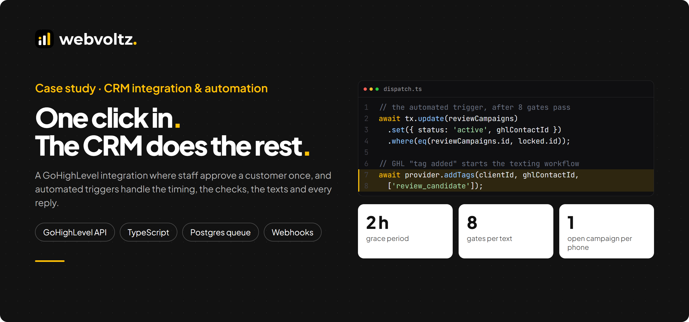
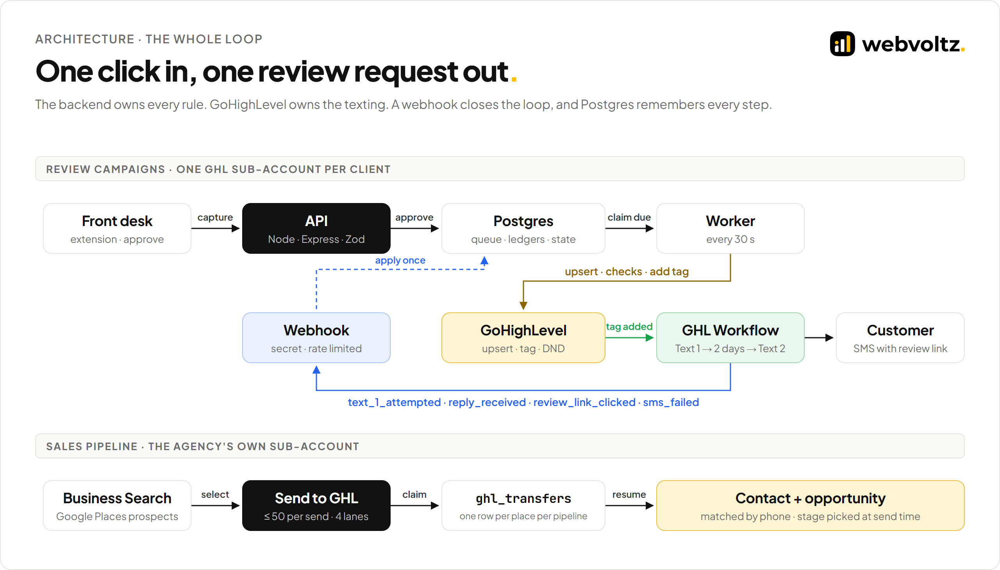
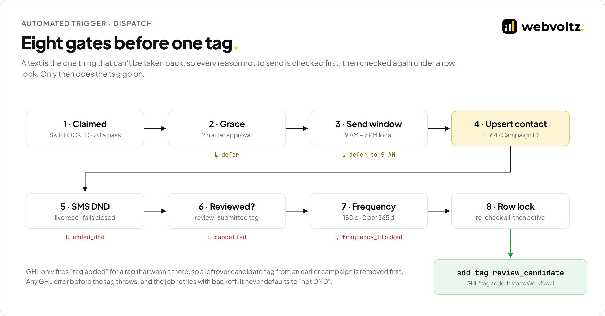
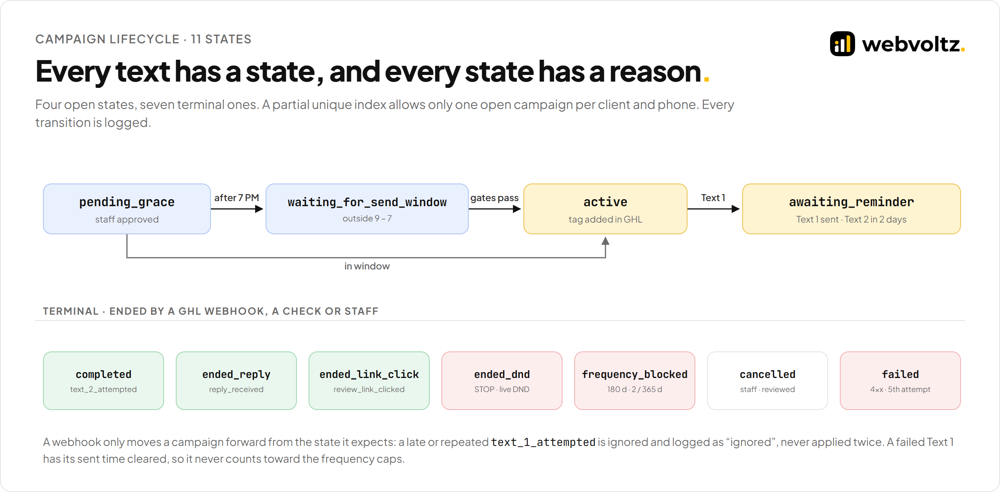
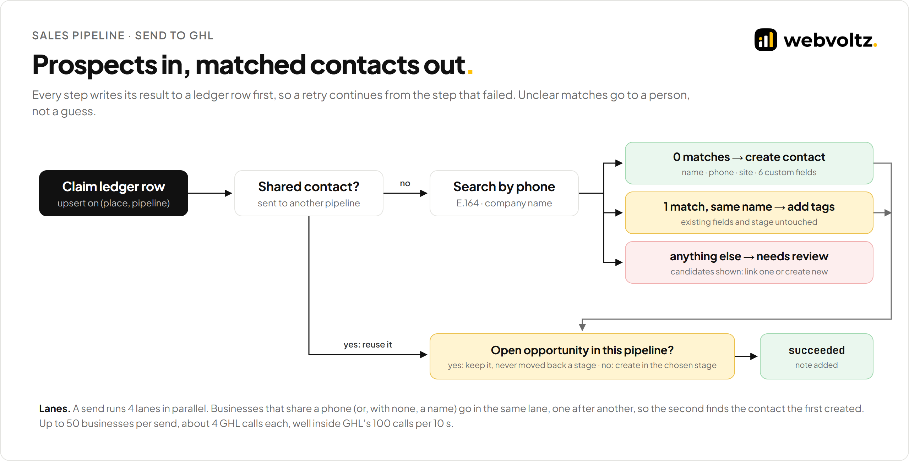
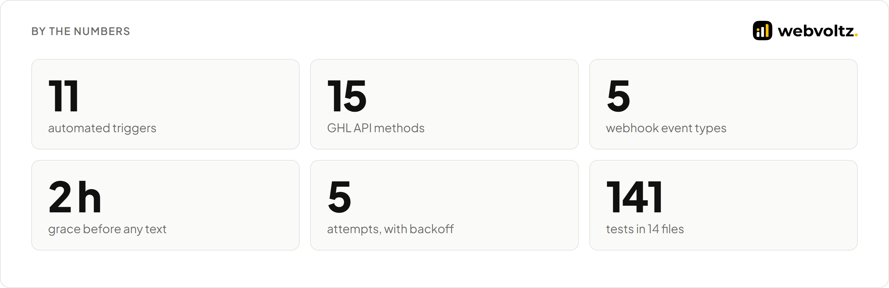
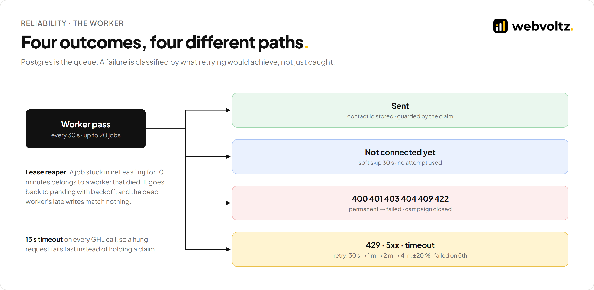
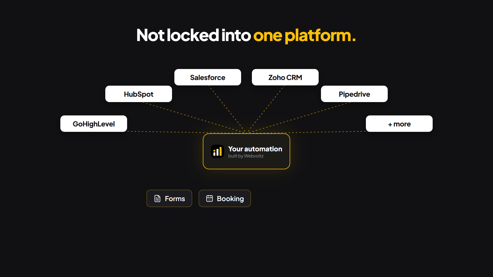

<p align="center">
  
</p>

<p align="center">
  <a href="#what-we-built">What we built</a> ·
  <a href="#by-the-numbers">By the numbers</a> ·
  <a href="ARCHITECTURE.md">Architecture</a> ·
  <a href="RELIABILITY-AND-SECURITY.md">Reliability and security</a> ·
  <a href="#risks-and-how-we-handled-them">Risks</a> ·
  <a href="#walkthrough-video">Video</a>
</p>

---

## The outcome

We built a GoHighLevel (GHL) integration for a reputation agency that serves local clinics and service businesses. Front-desk staff approve a customer with one click. From there, automated triggers decide when to text, check every reason not to, hand the customer to the client's own GHL account, and follow every reply back.

- **One click, then hands off.** The backend waits out a grace period, respects a send window, opt-outs and frequency caps, then starts the client's GHL texting workflow by adding a single tag.
- **The loop closes.** GHL reports sends, replies, link clicks, STOPs and failures by webhook. Each event moves the campaign to its next state exactly once, even when GHL delivers it twice.
- **Nothing lost, nothing doubled.** Postgres is the job queue and the ledger. Workers claim jobs with `SKIP LOCKED`, retry with backoff, and a database index allows only one open campaign per phone.
- **A second integration** sends prospects found in a Business Search tool straight into a sales pipeline in the agency's own GHL account, matched to existing contacts instead of duplicating them.

> This repository is a technical case study. It shows how we structure, write and ship this kind of integration through selected excerpts, diagrams and a walkthrough video. The client is not named, every name and phone number shown is made up, and the full source is not published. See [Notice](#notice).

---

## The problem

Asking a happy customer for a review is simple. Doing it automatically, for many businesses, through a CRM you don't control, is not:

1. **Texts can't be taken back.** A text to someone who opted out, a second text a week after the first, or a text at 11 PM costs the client trust. Every reason not to send has to be checked before the send, not after.
2. **Two systems, one truth.** The texting runs inside each client's GHL workflows. Our backend has to start them at the right moment and then learn what happened, from webhooks that can arrive late, twice, or with hand-typed field names.
3. **Things fail halfway.** GHL rate-limits, times out and has bad minutes. A worker can crash between creating a contact and tagging it. A retry must pick up where it stopped, never start a second campaign.

---

## What we built

<p align="center"></p>

### An automated trigger with eight gates

When staff approve a customer, a campaign opens in `pending_grace`. A worker pass every 30 seconds claims due jobs and runs them through eight gates: grace period, send window, contact upsert, live SMS DND from GHL, an already-reviewed tag, frequency caps, and a final re-check under a row lock. Only then does it add `review_candidate`, the tag that starts the client's GHL workflow. ([`dispatch.ts`](src/triggers/dispatch.ts))

<p align="center"></p>

### GoHighLevel, set up for you

Connecting a client's sub-account tests the token live, rolls back on failure, then provisions everything its workflows rely on: a review trigger link, 2 custom fields, the SMS copy as custom values, the webhook URL and secret, and 12 workflow tags. It is create-if-missing by name, so running it twice changes nothing, and it never overwrites copy staff edited in GHL. ([`provisioning.ts`](src/crm/provisioning.ts))

### Webhooks that apply exactly once

GHL workflows call back with five event types. The endpoint authenticates before it reveals anything, normalises GHL's free-form payload, checks the contact and phone agree with the campaign, and records the event in an idempotency ledger in the same transaction that applies it. A redelivery hits the ledger and changes nothing. Every call is logged as applied, ignored or rejected. ([`receive.ts`](src/webhooks/receive.ts), [`applyEvent.ts`](src/webhooks/applyEvent.ts))

<p align="center"></p>

### Prospects into a sales pipeline

Business Search finds local businesses through Google Places. An admin picks a pipeline and a stage, which are read live from GHL, and sends up to 50 businesses. Each one gets a contact and an opportunity: matched by phone to an existing contact where that's certain, created where there's no match, and handed to a person where it's unclear. A ledger row per business and pipeline makes the send safe to retry. ([`transfer.ts`](src/pipeline/transfer.ts))

<p align="center"></p>

---

## By the numbers

<p align="center"></p>

Every figure comes from the code: constants, the provider interface, the webhook schema, and a count of the test cases in the integration's 14 test files. The tests run against a real Postgres, with in-memory GHL fakes injected.

---

## How it's engineered

| Area | Decision | Why |
| --- | --- | --- |
| Queue | Postgres rows with `next_attempt_at`, a claim lease and `FOR UPDATE SKIP LOCKED`. | No broker to run or keep in sync. A job and its state commit together. |
| Claims | Every outcome write is guarded by `status = 'releasing' AND claimed_at = <this claim>`. | A worker that stalled past its lease can't overwrite the job's newer claim. |
| Failures | GHL errors classified: 4xx permanent, 429/5xx/network retryable, "not connected" a soft skip. | Retrying a bad request burns rate limit; not retrying an outage loses texts. |
| Backoff | 30 s, 1 m, 2 m, 4 m with ±20 % jitter, failed on the 5th attempt. | A GHL blip doesn't bring every job back at the same instant. |
| Duplicates | A partial unique index: one open campaign per client and phone. | The database, not app code, guarantees it, even under concurrent approvals. |
| Idempotency | One ledger table, scoped keys (`ghl_release`, `ghl_campaign_event`, …). | Retries and webhook redeliveries resolve to the same result. |
| Trigger | The tag goes on only after a commit; a leftover tag is removed first. | GHL fires "tag added" once per new tag, so a re-run must re-arm it. |
| Webhooks | Shared secret compared in constant time; 401 for every auth failure. | Nothing about clients or campaigns leaks to an unauthenticated caller. |

The full write-up, with excerpts, is in **[ARCHITECTURE.md](ARCHITECTURE.md)**.

<p align="center"></p>

---

## Risks and how we handled them

| Risk | What could go wrong | How we handled it |
| --- | --- | --- |
| Texting an opted-out customer | A STOP in GHL is missed | Live DND read from GHL right before the tag. A GHL error throws and retries; it never defaults to "not DND". |
| Texting too often | A customer gets texts every visit | 180-day cooldown and 2 per 365 days, counted only from texts that were really sent. |
| Texting at night | A send lands at 11 PM | 9 AM – 7 PM window, checked before and again inside the final transaction. |
| Two campaigns for one phone | A retry or two approvals race | Partial unique index on open campaigns. A retried approval of the same request is idempotent. |
| Worker crash mid-send | A job is stuck, or sent twice | 10-minute claim lease, a reaper, guarded writes, and a ledger that remembers the created contact. |
| Webhook delivered twice or late | A state moves twice, or backwards | Idempotency ledger in the same transaction, and events only apply from the state they expect. |
| Webhook from the wrong place | A forged or mis-mapped event | Secret header, client resolved from the GHL location, contact and phone cross-checked against the campaign. |
| Duplicate contacts in the pipeline | Two sends create two contacts | Ledger per place and pipeline, same-phone businesses in one lane, unclear matches go to a person. |
| Workflow edited in GHL | Missing fields break the mapping | Provisioning re-creates what's missing; a missing Campaign ID field fails the job loudly instead of texting blind. |

Known limits are listed openly in [Reliability and security](RELIABILITY-AND-SECURITY.md#known-limits).

---

## Repository map

```text
.
├── README.md                        this page
├── ARCHITECTURE.md                  triggers, GHL client, webhooks, pipeline, decision log
├── RELIABILITY-AND-SECURITY.md      failure handling, threat model, data, limits
├── src/
│   ├── crm/                         GHL request wrapper, provisioning
│   ├── triggers/                    job store, worker, dispatch gates, release, send window
│   ├── campaigns/                   campaign rules: open, frequency, end
│   ├── webhooks/                    auth, payload normalising, exactly-once apply
│   ├── pipeline/                    Business Search → contact + opportunity
│   └── db/                          the tables behind it
├── assets/                          diagrams, banner, brand
└── video/                           four videos with scripts and storyboards
```

---

## Tech stack

| Layer | Technology |
| --- | --- |
| API | Node 22, TypeScript, Express, Zod |
| Data | PostgreSQL 16, Drizzle ORM, SQL migrations |
| Background work | In-process worker loops over a Postgres queue (`SKIP LOCKED`), heartbeat |
| CRM | GoHighLevel API v2 (LeadConnector), Private Integration Tokens, workflow webhooks |
| Dashboard | React, Vite, Redux Toolkit Query, Tailwind CSS |
| Quality | Vitest against a real Postgres, in-memory GHL fakes, ESLint, Prettier |
| Delivery | Docker, CI pipeline, staged environments |

---

## Walkthrough video

A 73-second look at what Webvoltz builds: the everyday mess of missed follow-ups, duplicate data and tools that don't talk to each other; how we map a business's process, connect the systems it already uses and automate the steps in between; automation running in a sales pipeline; working across CRM platforms; what it changes for the business; and this project as a real example. Narration script: [`crm-showcase-script.md`](video/crm-showcase-script.md).

<p align="center"><a href="video/crm-showcase.mp4"></a></p>

<p align="center"><a href="video/crm-showcase.mp4">Watch the video (1:13, 1080p)</a></p>

**More videos in [`video/`](video):**

- [`product-demo.mp4`](video/product-demo.mp4) (1:23): a software walkthrough of this project: the front-desk prompt, the Review Requests dashboard, how the request flows to GoHighLevel, the job queue, the workflow and the webhook loop. [Script](video/product-demo-script.md) · [storyboard](video/product-demo-storyboard.md).
- [`walkthrough.mp4`](video/walkthrough.mp4) (1:29): a 3D product film of the same system. [Script](video/script.md) · [storyboard](video/storyboard.md).
- [`walkthrough-v1.mp4`](video/walkthrough-v1.mp4) (0:55): the first, shorter cut.

---

## About Webvoltz

Webvoltz builds the technology systems businesses compete, operate and scale on: web platforms, product engineering, automation, integrations and managed delivery teams. One accountable partner from first strategy session to ongoing delivery.

[**Book a strategy call**](https://webvoltz.com) to talk through a CRM integration, automated workflows or a system that has to stay in sync with one.

---

## Notice

Copyright © 2026 Webvoltz. All rights reserved.

This repository is published for viewing and evaluation only. The code excerpts, designs, diagrams and recordings may not be copied, modified, redistributed or used in other work without written permission. See [`NOTICE.md`](NOTICE.md).
